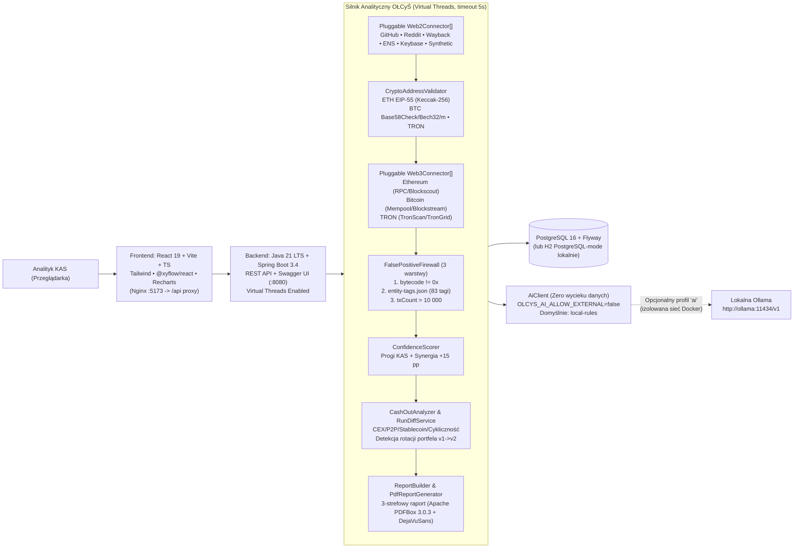
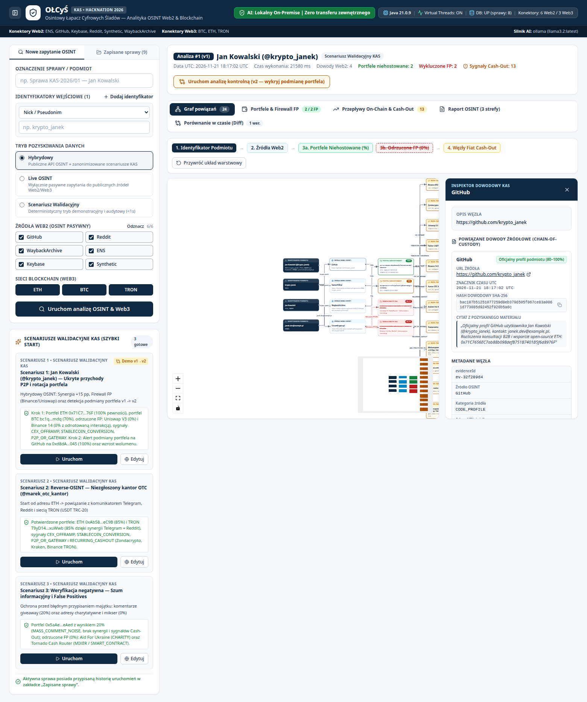
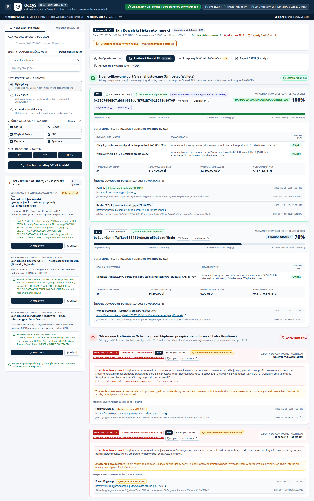
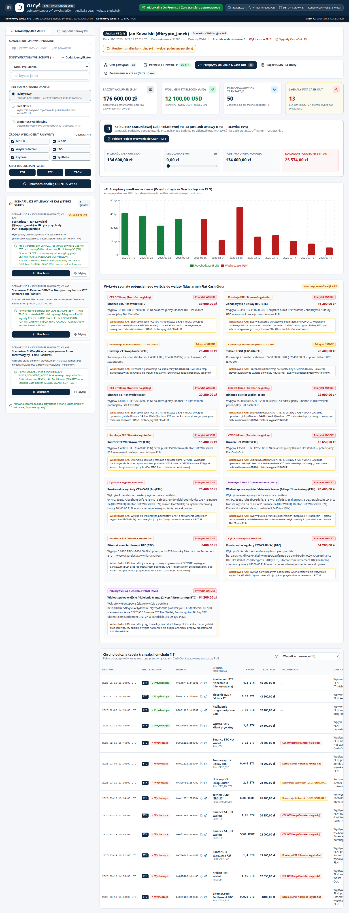
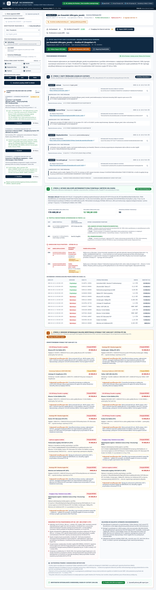
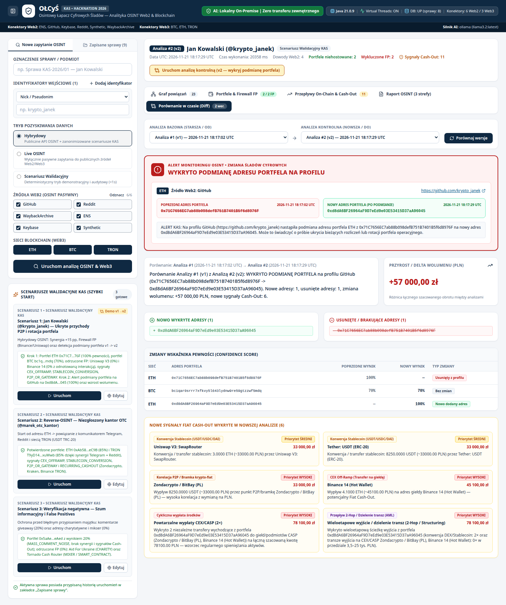

# OŁCyŚ — Osintowy Łapacz Cyfrowych Śladów

> **System analityczny OSINT (Web2) + analiza blockchain (Web3) dla Krajowej Administracji Skarbowej (KAS)**  
> Projekt zrealizowany w ramach **HackNation 2026** (wyzwanie KAS: *„Jak identyfikować i oceniać powiązania pomiędzy cyfrowymi śladami a adresami krypto”*).

[](https://openjdk.org/projects/jdk/21/)
[](https://spring.io/projects/spring-boot)
[](https://react.dev/)
[](https://www.postgresql.org/)
[](#-audyt-licencji-open-source)

---

## Spis treści

1. [Opis projektu: Problem PIT-38 i rozwiązanie OŁCyŚ](#-opis-projektu-problem-pit-38-i-rozwiązanie-ołcyś)
2. [Założenia projektu, parametry wyszukiwania i bezpieczeństwo OSINT](#-założenia-projektu-parametry-wyszukiwania-i-bezpieczeństwo-osint)
3. [Metodyka analityczna KAS](#-metodyka-analityczna-kas)
4. [Architektura rozwiązania](#-architektura-rozwiązania)
5. [Jak uruchomić aplikację (4 warianty krok po kroku)](#-jak-uruchomić-aplikację-4-warianty-krok-po-kroku)
6. [Sposoby używania systemu OŁCyŚ (UI, Swagger, CLI)](#-sposoby-używania-systemu-ołcyś-ui-swagger-cli)
7. [Testy i weryfikacja (JUnit 5, Vite, E2E API Check)](#-testy-i-weryfikacja-junit-5-vite-e2e-api-check)
8. [Kontrakt REST API i OpenAPI / Swagger UI](#-kontrakt-rest-api-i-openapi--swagger-ui)
9. [Audyt licencji Open Source i źródła danych](#-audyt-licencji-open-source-i-źródła-danych)
10. [Scenariusze walidacyjne KAS, przykłady JSON, logi i zrzuty ekranu](#-scenariusze-walidacyjne-kas-przykłady-json-logi-i-zrzuty-ekranu)
11. [Macierz zgodności z dokumentem `OSINT.pdf` i materiały konkursowe](#-macierz-zgodności-z-dokumentem-osintpdf-i-materiały-konkursowe)

---

## 🎯 Opis projektu: Problem PIT-38 i rozwiązanie OŁCyŚ

### Problem biznesowy i luka podatkowa (PIT-38)

Zgodnie z art. 30b ustawy o podatku dochodowym od osób fizycznych przychody z odpłatnego zbycia walut wirtualnych (wymiana kryptowalut na waluty tradycyjne takie jak PLN, EUR, USD, płatności za towary i usługi oraz rozliczenia w kantorach OTC/P2P) podlegają wykazaniu w rocznym zeznaniu **PIT-38**. W praktyce część uczestników rynku zakłada pełną anonimowość obrotu kryptoaktywami — nie składa zeznania PIT-38, zaniża podstawę opodatkowania lub szacuje wartość transakcji „na oko”.

Analitycy **Krajowej Administracji Skarbowej (KAS)** w ramach czynności sprawdzających i kontroli muszą łączyć rozproszone informacje z otwartego Internetu (profile w mediach społecznościowych, repozytoria kodu, ogłoszenia P2P, fora, archiwa stron) z aktywnością w publicznych sieciach blockchain. Ręczne wykonywanie tej pracy jest:
- **czasochłonne** — wymaga przeszukiwania wielu serwisów i eksploratorów bloków,
- **niepowtarzalne** — brak jednolitego standardu zapisu śladów, dat UTC i sum kontrolnych treści,
- **podatne na błędy przypisania** — przypadkowe przypisanie podatnikowi adresu gorącego portfela giełdy CEX, smart kontraktu DEX, miksera lub publicznej zbiórki charytatywnej.

### Rozwiązanie: OŁCyŚ

**OŁCyŚ (Osintowy Łapacz Cyfrowych Śladów)** to otwartoźródłowa, gotowa do wdrożenia **on-premise** platforma analityczna zbudowana w architekturze monorepo (**Java 21 + Spring Boot 3.4 + PostgreSQL 16 + React 19**), która automatyzuje pełny proces dochodzenia OSINT → Web3:

1. **Pasywnie zbiera ślady Web2** z publicznych, legalnych źródeł internetowych i zabezpiecza każdy dowód w modelu *Chain-of-Custody* (URL, timestamp UTC, hash `SHA-256` treści, cytat).
2. **Ekstrahuje i kryptograficznie weryfikuje adresy krypto** w sieciach **Ethereum (EIP-55 Keccak-256)**, **Bitcoin (Base58Check, SegWit Bech32, Taproot Bech32m)** i **TRON (Base58Check)**, eliminując 64-znakowe hashe transakcji oraz uszkodzone ciągi znaków.
3. **Odrzuca fałszywe trafienia (3-warstwowy Firewall False Positives)** — automatycznie wyklucza z przypisania osobistego (`0%`) smart kontrakty (`eth_getCode` → `bytecode != 0x`), adresy giełd CEX/CASP, routery DEX, kontrakty stablecoin, miksery, zbiórki charytatywne i adresy burn.
4. **Wylicza deterministyczny, wyjaśnialny Wskaźnik Pewności (Confidence Score 0–100%)** wraz z rozbiciem punktowym każdej reguły oraz **premią synergii +15 pp** za potwierdzenie z co najmniej dwóch niezależnych źródeł Web2.
5. **Wykrywa sygnały wyjścia do waluty fiducjarnej (Fiat Cash-Out) w 5 klasach** — przelewy na CEX/CASP (`CEX_OFFRAMP`), konwersje stablecoin (`STABLECOIN_CONVERSION`), korelacje czasowe z ogłoszeniami P2P/bramkami w oknie ±72h (`P2P_OR_GATEWAY`), cykliczne wypłaty (`RECURRING_CASHOUT`) oraz wieloetapowe wyjścia i dzielenie transz 3,5–25 tys. PLN (`AML_STRUCTURING_OR_2HOP`).
6. **Monitoruje zmiany w czasie (Diff v1 → v2) oraz harmonogramy CRON w DB** — wykrywa podmianę adresu portfela opublikowanego na profilu podmiotu, nowo dodane adresy i przyrost wolumenu w PLN (`monitoring_schedules` w Flyway `V2`).
7. **Generuje czytelny raport OSINT w 3 wyraźnych strefach** (Fakty Źródłowe → Wyniki Obliczeń → Wnioski do Dalszej Weryfikacji) wraz z kalkulatorem luki podatkowej 19% PIT-38 (`art. 30b ustawy o PIT`), projektem wezwania do podmiotów CASP w PDF (`art. 182 Ordynacji podatkowej / DAC8 / MiCA`) oraz pełnym eksportem JSON i PDF (`Apache PDFBox 3.0.3` z polskimi znakami).

---

## 🛡️ Założenia projektu, parametry wyszukiwania i bezpieczeństwo OSINT

### 1. Legalność i granice białego wywiadu (OSINT)
System działa w ścisłej zgodności z wymaganiami sekcji 7 dokumentacji wyzwania KAS:
- Korzysta **wyłącznie z pasywnych, publicznie dostępnych, jawnych i legalnych źródeł** (publiczne API HTTP, otwarte profile, fora, archiwa Wayback Machine, resolver ENS, publiczne RPC i eksploratory blockchain).
- **Nie wykonuje** żadnych działań aktywnych ani inwazyjnych: brak skanowania portów/podatności (np. `nmap`), brak obchodzenia uwierzytelniania lub limitów dostępu, brak phishingu, brak logowania na cudze konta i brak korzystania z wycieków danych osobowych.
- Ustawia przejrzysty nagłówek `User-Agent: OLCyS-KAS-OSINT/1.0` (`Web2ConnectorSupport.java`) oraz bezpieczne timeouty zapytań (`connect = 3s`, `read = 5s`, `olcys.connectors.timeout-seconds: 5`).

### 2. Akceptowane identyfikatory wejściowe (`IdentifierDto`)
Analizę można rozpocząć od jednego lub wielu identyfikatorów dowolnego typu (w tym w trybie **Reverse OSINT** — od samego adresu kryptowalutowego):

| Typ (`type`) | Opis dla analityka KAS | Przykładowa wartość (`value`) | Zastosowanie w konektorach |
| :--- | :--- | :--- | :--- |
| `FULL_NAME` | Imię i nazwisko podmiotu | `Jan Kowalski` | Dopasowanie profili, archiwów i korelacji |
| `NICK` | Nick / pseudonim forumowy lub deweloperski | `krypto_janek` | GitHub (`/users/{nick}`), Reddit, scenariusze |
| `EMAIL` | Adres e-mail | `janek.dev@example.pl` | Ekstrakcja własnych domen firmowych do Wayback CDX (z odfiltrowaniem domen ogólnych jak `gmail.com`, `wp.pl`, `onet.pl`) |
| `TELEGRAM_ID` | Identyfikator / handle komunikatora Telegram | `@marek_otc_kantor` | Korelacja kanałów OTC i komunikatorów |
| `SOCIAL_LOGIN` | Login z portalu społecznościowego | `u/krypto_janek` | Profile społecznościowe i serwisy dyskusyjne |
| `CRYPTO_ADDRESS` | Publiczny adres krypto (Reverse OSINT) | `0xAb5801a7D398351b8bE11C439e05C5B3259aeC9B` | Wyszukiwanie wsteczne śladów Web2, analiza ENS oraz bezpośrednia inspekcja on-chain |

### 3. Parametry uruchomienia i tryby analizy (`AnalysisMode`)

| Parametr | Typ / Wartości | Opis działania |
| :--- | :--- | :--- |
| `displayName` | `string` (wymagane) | Oznaczenie sprawy lub nazwa podmiotu (np. `Jan Kowalski (@krypto_janek)`) |
| `identifiers` | `IdentifierDto[]` (`>= 1`) | Lista identyfikatorów wejściowych `[{ "type": "...", "value": "..." }]` |
| `mode` | `HYBRID` \| `LIVE` \| `SYNTHETIC` | **`HYBRID`**: równoległe zapytania live do publicznych API + scenariusze walidacyjne.<br>**`LIVE`**: wyłącznie pasywne zapytania do publicznych API Web2/Web3.<br>**`SYNTHETIC`**: w pełni deterministyczny tryb offline (`< 1s`) dla powtarzalnych testów i walidacji KAS. |
| `sources` | `string[]` | Lista aktywnych źródeł Web2 (`GitHub`, `Reddit`, `WaybackArchive`, `ENS`, `Keybase`, `Synthetic`) |
| `networks` | `string[]` | Zakres monitorowanych sieci Web3 (`ETH`, `BTC`, `TRON`) |
| `snapshotStep` | `integer` (domyślnie `1`) | Numer kroku migawki czasowej (`1` = analiza bazowa v1, `2` = analiza kontrolna v2 do detekcji rotacji portfela) |

### 4. Współbieżność i ochrona przed wyciekiem danych (Zero External Data Transfer)
- **Java 21 Virtual Threads:** `spring.threads.virtual.enabled: true` w `application.yml` oraz równoległe wykonywanie konektorów Web2 i Web3 (`Executors.newVirtualThreadPerTaskExecutor()`) z twardym limitem **5 sekund** na zapytanie konektora i bezpiecznym przechwytywaniem wyjątków sieciowych (błąd pojedynczego API nie przerywa analizy).
- **Brak zewnętrznego wycieku danych (`OLCYS_AI_ALLOW_EXTERNAL=false`):** system ma zablokowaną komunikację z zewnętrznymi, komercyjnymi API AI (OpenAI, Gemini, Anthropic).
- **Wymienny adapter AI (`AiClient`):**
  - Domyślnie działa deterministyczny profil `local-rules` (zero zależności zewnętrznych, 100% powtarzalności).
  - Opcjonalnie obsługuje lokalny serwer LLM **Ollama** (`OLCYS_AI_PROVIDER=ollama`, `OLCYS_AI_BASE_URL=http://ollama:11434/v1`, `OLCYS_AI_MODEL=llama3.2:latest`) uruchamiany w tej samej izolowanej sieci Dockera (profil `ai`).
  - Endpoint `/api/health` stale raportuje flagę `externalDataTransfer: false`, widoczną na stałym zielonym pasku w nagłówku aplikacji.

---

## 🔬 Metodyka analityczna KAS

### Krok 1: Ekstrakcja i kryptograficzna walidacja adresów (`CryptoAddressValidator`)
Z surowych treści Web2 automatycznie wyodrębniane i weryfikowane są adresy kryptowalutowe z odrzuceniem 64-znakowych hashy transakcji i zniekształconych ciągów:

| Sieć | Format sumy kontrolnej | Mechanizm weryfikacji w `CryptoAddressValidator.java` |
| :--- | :--- | :--- |
| **Ethereum (`ETH`)** | `EIP-55` | Regex `(?<![0-9a-fA-F])0x[0-9a-fA-F]{40}(?![0-9a-fA-F])` (odfiltrowuje 64-znakowe hashe TX); weryfikacja mieszanej wielkości liter przez **Keccak-256** (`Bouncy Castle bcprov-jdk18on`) oraz normalizacja do kanonicznego formatu EIP-55. |
| **Bitcoin Legacy / P2SH (`BTC`)** | `BASE58CHECK` | Długość 26–35 znaków, prefiks `1` (`0x00`) lub `3` (`0x05`), dekodowanie do 25 bajtów i sprawdzenie 4-bajtowej sumy kontrolnej `SHA-256(SHA-256(payload))`. |
| **Bitcoin SegWit / Taproot (`BTC`)** | `BECH32` / `BECH32M` | Prefiks `bc1`, weryfikacja wielomianowa Bech32 (`0x00000001` dla witness v0 — 20/32 bajty) oraz Bech32m (`0x2bc830a3` dla witness v1 Taproot — 32 bajty), odrzucenie mieszanego case'u. |
| **TRON (`TRON`)** | `TRON_BASE58CHECK` | Długość 34 znaki, prefiks `T` (bajt wersji `0x41`), dekodowanie do 25 bajtów oraz double `SHA-256`. |

### Krok 2: 3-warstwowy Firewall False Positives
Każdy zwalidowany adres przed przypisaniem osobie fizycznej przechodzi przez trzy niezależne warstwy ochronne:

1. **Warstwa 1 — Inspekcja kodu bajtowego (`eth_getCode`):**
   - Odpytanie publicznego węzła JSON-RPC (`ethereum-rpc.publicnode.com`) metodą `eth_getCode` oraz sprawdzenie flagi `is_contract` / `accountType` w eksploratorach.
   - Jeśli `bytecode != "0x"` (adres zawiera kod wykonywalny), zostaje oznaczony jako **`SMART_CONTRACT`** i odrzucony z wynikiem **`0%`** (np. router Uniswap V3).
2. **Warstwa 2 — Rejestr znanych podmiotów (`entity-tags.json` + etykiety API):**
   - Wbudowana baza **83 zweryfikowanych adresów publicznych** (`EntityTagRegistry`) w sieciach `ETH` (64), `BTC` (10) i `TRON` (9) podzielona na 7 ról:
     - `CEX` (38) — gorące i zimne portfele giełd (Binance, Kraken, Coinbase, OKX, Bitfinex, Bybit, KuCoin, Gate.io, Crypto.com, HTX),
     - `CASP_P2P` (11) — polskie i europejskie podmioty wymiany/bramki (Zondacrypto / BitBay, Ramp Network, MoonPay, Ari10, Revolut, Kantor OTC Warszawa, Bitomat.com),
     - `DEX_ROUTER` (10) — routery i pule DeFi (Uniswap V2/V3, 1inch, SushiSwap, Curve 3pool, Aave V3, PancakeSwap, 0x),
     - `STABLECOIN` (8) — kontrakty emisji tokenów (USDT, USDC, DAI, FDUSD, PYUSD, BUSD),
     - `MIXER` (6) — kontrakty mikserów objętych sankcjami (Tornado Cash Router + pule depozytowe),
     - `CHARITY` (6) — publiczne zbiórki humanitarne i grantowe (Aid For Ukraine, Binance Charity, Giveth, Gitcoin, PAH),
     - `BURN` (4) — nieodwracalne adresy spalania (`0x...dEaD`, `0x000...000`, `1BitcoinEater...`).
   - Adresy te otrzymują twarde wykluczenie **`0%`**. W przypadku `CEX` i `CASP_P2P` system stosuje regułę KAS: **nie przypisuje portfela giełdowego podatnikowi**, ale zachowuje flagę **`interactionRecorded = true`** (fakt interakcji potwierdzonego portfela podmiotu z daną giełdą jest widoczny jako ślad Cash-Out).
3. **Warstwa 3 — Heurystyka wolumenowa (`txCount > 10 000`):**
   - Adresy przekraczające 10 000 transakcji bez jawnego tagu oznaczane są flagą `SUSPECTED_CUSTODIAL` z ostrzeżeniem analitycznym przed błędnym przypisaniem portfela usługowego/powierniczego.

### Krok 3: Deterministyczny algorytm Confidence Score (0–100%)
Punktacja dla adresów nieodrzuconych przez Firewall FP jest w **100% deterministyczna, powtarzalna i wyjaśnialna** (każda reguła trafia do `scoreBreakdown` z `ruleId`, `label`, `delta`, `evidenceIds`, `explanationPl`):

| Kategoria kontekstu źródła Web2 | Przedział KAS | Próg bazowy | Przykładowe źródło i uzasadnienie |
| :--- | :---: | :---: | :--- |
| `OWN_PROFILE_VERIFIED` | 80–100% | **85%** | Oficjalny, autorski profil podmiotu (GitHub, rekord ENS, własna strona) |
| `TRANSACTIONAL_CONTEXT` | 60–79% | **70%** | Ogłoszenie sprzedaży P2P/OTC, stopka e-maila firmowego, kanał rozliczeniowy |
| `FORUM_DISCUSSION` | 40–59% | **50%** | Wzmianka w dyskusji na forum branżowym lub Reddit (wymaga drugiego śladu) |
| `MASS_COMMENT_NOISE` | 10–39% | **20%** | Masowe komentarze konkursowe, airdropy, giveawaye |
| `FALSE_POSITIVE` | 0% | **0%** | Twardy sufit dla CEX, Smart Contract, Mixer, Charity, Burn (bez prawa do premii!) |

**Reguła Synergii (`+15 pp`, limit `100%`):**
- Dowody są grupowane po **niezależnej platformie / domenie Web2** (wielokrotne wystąpienie adresu w jednym serwisie liczy się jako 1 źródło).
- Jeśli ten sam adres niehostowany występuje w **`>= 2` niezależnych źródłach**, do wyniku bazowego dodawana jest premia **`+15 punktów procentowych`** (maksymalnie `100%`).
- Przykłady z walidacji:
  - GitHub (`85%`) + KantorP2P.pl (`+15 pp` synergia) = **`100%`** (Scenariusz 1).
  - Telegram OTC (`70%`) + Reddit (`+15 pp` synergia) = **`85%`** (Scenariusz 2).
  - Reddit giveaway (`20%`, 1 źródło) = **`20%`** (Scenariusz 3).

### Krok 4: Detekcja Fiat Cash-Out, analiza przepływów i Diff czasowy (v1 → v2)
- **5 klas sygnałów Fiat Cash-Out (`CashOutSignalDto`):**
  1. `CEX_OFFRAMP` — transfer wychodzący na gorący/depozytowy portfel giełdy CEX (np. Binance, Kraken).
  2. `STABLECOIN_CONVERSION` — znaczące transfery lub swapy na stablecoiny (`USDT`, `USDC`, `DAI`, w tym przez routery DEX).
  3. `P2P_OR_GATEWAY` — korelacja ogłoszenia P2P/OTC z transakcją wychodzącą w oknie ±72h lub przelew do operatora bramki/kantoru (`CASP_P2P`: Zondacrypto, Ramp Network, Bitomat.com, Kantor OTC).
  4. `RECURRING_CASHOUT` — powtarzalne, cykliczne wypłaty zbliżonych kwot (np. regularne cotygodniowe transze ~4 850–5 050 USDT).
  5. `AML_STRUCTURING_OR_2HOP` — wieloetapowe wyjście (swap DEX/stablecoin -> wypłaty w transzach na CEX/CASP w przedziale 3,5–25 tys. PLN).
- **Porównywanie analiz w czasie (`RunDiffDto`):** przy cyklicznym uruchomieniu analizy dla tej samej sprawy system porównuje migawki dowodowe z PostgreSQL. Jeżeli pod tym samym źródłem i URL (np. `https://github.com/krypto_janek`) pojawił się nowy adres portfela zastępujący poprzedni, ustawia flagę **`walletRotationDetected = true`**, zapisuje obiekt `WalletRotationEventDto` i oblicza `volumeDeltaPln` oraz `newCashOutSignals`.

### Krok 5: 3-strefowy raport OSINT (UI + PDFBox + JSON)
Raport końcowy rozdziela bezwzględnie materiał dowodowy, obliczenia i hipotezy dochodzeniowe:
1. **Strefa 1 — Fakty Źródłowe (`zone1SourceFacts`):** niemodyfikowalne artefakty Chain-of-Custody (źródło, URL, data pobrania UTC, skrót `SHA-256`, dopasowany identyfikator, dokładny cytat, wykryte adresy).
2. **Strefa 2 — Wyniki Obliczeń (`zone2Computations`):** 100% deterministyczne obliczenia — opis metodyki, tabela zatwierdzonych portfeli niehostowanych z rozbiciem punktowym, tabela odrzuconych False Positives (`0%`) wraz z flagą `interactionRecorded`, łączne wolumeny PLN/USD oraz chronologiczna tabela przepływów.
3. **Strefa 3 — Wnioski Wymagające Dalszej Weryfikacji (`zone3VerificationConclusions`):** wykryte sygnały Fiat Cash-Out, wskaźniki ryzyka podatkowego **PIT-38 (art. 30b ustawy o PIT)**, rekomendowane kroki dochodzeniowe KAS (np. wystąpienie do CASP na podstawie dyrektywy DAC8 / art. 182 Ordynacji podatkowej) oraz ograniczenia i zastrzeżenia prawne.

---

## 🏗️ Architektura rozwiązania

Projekt zorganizowano jako pojedyncze **monorepo** z łatwą konteneryzacją i architekturą pluginową w Spring Boot (automatyczne wstrzykiwanie `List<Web2Connector>` oraz `List<Web3Connector>`).



### Struktura katalogów monorepo

```text
olcys/
├── AGENTS.md                         # Specyfikacja architektoniczna i kontrakt systemu
├── OSINT.pdf                         # Oficjalna dokumentacja wyzwania KAS
├── docker-compose.yml                # postgres:16-alpine, backend, frontend (+ profil ai: ollama)
├── README.md                         # Dokumentacja KAS, audyt licencji i instrukcja użycia
├── docs/
│   ├── FINAL_PITCH_SCRIPT.md                         # Scenariusz wystąpienia live Etap 2 (2:50 min + Q&A)
│   ├── OLCyS_Prezentacja_KAS_10_Slajdow.pdf          # Prezentacja PDF (10 slajdów)
│   ├── PREZENTACJA_10_SLAJDOW_I_SCENARIUSZ_WIDEO.md  # Konspekt 10 slajdów PDF + scenariusz 180s wideo
│   ├── VOICEOVER_SCRIPT.txt                          # Tekst narracji lektora z timestampami (2:45 min)
│   ├── demo_subtitles.srt                            # Napisy PL (UTF-8) zsynchronizowane z nagraniem
│   ├── olcys_demo.mp4                                # Film demonstracyjny (2:45 min Full HD 1920×1080 30fps H.264)
│   ├── prezentacja_etap1.pdf                         # Samodzielna prezentacja Etap 1 (5 slajdów PDF 16:9)
│   ├── prezentacja_etap2_tlo.pdf                     # Minimalistyczne slajdy tła na finał live (3 slajdy PDF)
│   ├── screenshots/                                  # 5 zrzutów ekranu UI (01–05)
│   └── slides/                                       # Źródła HTML/CSS prezentacji PDF (16:9)
├── scripts/
│   ├── record_demo.mjs               # Reproducible Playwright + FFmpeg recorder (1920×1080)
│   └── run-demo-check.sh             # Skrypt walidacji E2E (curl + jq) dla API i raportu PDF
├── backend/
│   ├── pom.xml                       # Maven: Spring Boot 3.4, Java 21, PDFBox 3.0.3, BouncyCastle 1.79, Springdoc
│   ├── Dockerfile                    # Multi-stage (maven:3.9 + eclipse-temurin:21-jre-alpine + ttf-dejavu)
│   └── src/
│       ├── main/resources/
│       │   ├── application.yml       # Virtual Threads, Springdoc, ustawienia AI & konektorów
│       │   ├── application-local.yml # Profil H2 w trybie zgodności PostgreSQL
│       │   ├── application-test.yml  # Profil testów JUnit 5
│       │   ├── db/migration/
│       │   │   ├── V1__init.sql
│       │   │   └── V2__monitoring_schedules.sql
│       │   ├── data/entity-tags.json # 83 zweryfikowane tagi (CEX, CASP_P2P, DEX, Stablecoin, Mixer, Charity, Burn)
│       │   ├── data/scenarios.json   # 3 zanonimizowane/syntetyczne scenariusze walidacyjne KAS
│       │   └── fonts/                # DejaVuSans.ttf & DejaVuSans-Bold.ttf (polskie znaki w PDF)
│       └── main/java/pl/kas/olcys/
│           ├── api/dto/              # 25 niezmiennych rekordów/enumów DTO (kontrakt JSON camelCase)
│           ├── config/               # WebConfig (RestClient, CORS, OpenAPI), AiProperties
│           ├── connector/web2/       # Interfejs Web2Connector + 6 implementacji (GitHub, Reddit, Wayback, ENS, Keybase, Synthetic)
│           ├── connector/web3/       # Interfejs Web3Connector + ETH/BTC/TRON + EntityTagRegistry
│           ├── crypto/               # CryptoAddressValidator (EIP-55, Base58Check, Bech32/m, SHA-256)
│           ├── domain/               # Encje JPA i repozytoria Spring Data
│           ├── engine/               # Silnik analizy, firewall FP, scoring, cash-out, diff, AiClient
│           └── report/               # Generator 3-strefowego raportu (JSON + Apache PDFBox 3.0.3)
└── frontend/
    ├── package.json                  # React 19, Vite 6, TypeScript 5.9, Tailwind 4, @xyflow/react, Recharts
    ├── Dockerfile                    # Multi-stage (node:22-alpine + nginx:1.27-alpine)
    ├── nginx.conf                    # Reverse proxy /api/ -> backend:8080/api/
    └── src/
        ├── types/api.ts              # Wierny mirror 1:1 rekordów Java DTO
        ├── api/client.ts             # Klient REST Fetch API
        ├── utils/formatters.ts       # Formatowanie PLN/USD/UTC i słowniki KAS PL
        └── components/               # SearchForm, EvidenceGraph, AddressCards, BlockchainFlow, HistoryDiff, OsintReportView
```

---

## 🚀 Jak uruchomić aplikację (4 warianty krok po kroku)

### Wymagania wstępne
- **Wariant kontenerowy (zalecany na produkcję/demo):** Docker Engine + Docker Compose v2 (`docker compose`).
- **Wariant lokalny (deweloperski):** JDK 21+ (skrypt `backend/mvnw` automatycznie dobiera właściwe `JAVA_HOME` z obsługą Java 21, jeśli domyślny `javac` w systemie ma starszą wersję), Maven 3.8+, Node.js 20+ / 22+ z `npm`.
- **Do skryptu walidacyjnego API:** `curl` i `jq`.

### Wariant A — Docker Compose (PostgreSQL 16 + Backend + Frontend, profil `local-rules`)
Najprostszy sposób uruchomienia całego środowiska on-premise jedną komendą z katalogu głównego:
```bash
cd /home/maks/HN/olcys
docker compose up --build
```
*(Aby uruchomić w tle: `docker compose up -d --build`, podgląd logów: `docker compose logs -f backend`, zatrzymanie: `docker compose down`.)*

### Wariant B — Docker Compose z lokalnym modelem LLM Ollama (profil `ai`)
Pełny stos kontenerowy z lokalnym serwerem LLM działającym wyłącznie w izolowanej sieci Dockera (`OLCYS_AI_ALLOW_EXTERNAL=false`):
```bash
cd /home/maks/HN/olcys
OLCYS_AI_PROVIDER=ollama docker compose --profile ai up --build
```
Przy pierwszym uruchomieniu pobierz model do kontenera Ollama:
```bash
docker exec -it olcys-ollama ollama pull llama3.2:latest
```
Jeśli kontener Ollama jest chwilowo niedostępny lub nie ma jeszcze modelu, `OpenAiCompatibleAiClient` automatycznie i bezpiecznie przełącza się na `LocalRulesAiClient` bez przerywania analizy.

### Wariant C — Uruchomienie lokalne bez Dockera (szybki tryb deweloperski na bazie H2)
Profil `local` uruchamia wbudowaną bazę H2 w trybie zgodności z PostgreSQL 16 oraz wykonuje migracje Flyway (`V1__init.sql`, `V2__monitoring_schedules.sql`) automatycznie przy starcie — nie wymaga uruchomionego serwera Postgres na porcie `5432`.

1. **Terminal 1 — Backend (port `8080`):**
   ```bash
   cd /home/maks/HN/olcys/backend
   ./mvnw spring-boot:run -Dspring-boot.run.profiles=local
   ```
   *(Jeśli chcesz uruchomić na innym porcie, np. `18080`, dodaj `-Dspring-boot.run.arguments="--server.port=18080"`).*
2. **Terminal 2 — Frontend (port `5173`, proxy `/api` → `http://localhost:8080`):**
   ```bash
   cd /home/maks/HN/olcys/frontend
   npm install
   npm run dev
   ```

### Wariant D — Uruchomienie z gotowego pliku JAR (tryb standalone)
```bash
cd /home/maks/HN/olcys/backend
./mvnw package -DskipTests
java -jar target/olcys-backend-1.0.0.jar --spring.profiles.active=local --server.port=8080
```

### Adresy usług po uruchomieniu
- **Interfejs analityczny KAS (Frontend):** `http://localhost:5173`
- **Backend REST API:** `http://localhost:8080`
- **Dokumentacja interaktywna Swagger UI:** `http://localhost:8080/swagger-ui.html`
- **Specyfikacja OpenAPI 3 (JSON):** `http://localhost:8080/v3/api-docs`
- **Baza PostgreSQL 16 (tylko wariant Docker):** `localhost:5433` (domyślnie mapowany przez `OLCYS_POSTGRES_PORT:-5433` na `5432` w kontenerze; baza `olcys`, użytkownik `olcys`)

### Kluczowe zmienne środowiskowe

| Zmienna | Wartość domyślna (`docker-compose.yml` / `application.yml`) | Rola |
| :--- | :--- | :--- |
| `SERVER_PORT` | `8080` | Port HTTP serwera Spring Boot |
| `SPRING_DATASOURCE_URL` | `jdbc:postgresql://postgres:5432/olcys` | Połączenie z bazą PostgreSQL 16 (w profilu `local` zastępowane przez H2 PostgreSQL-mode) |
| `SPRING_DATASOURCE_USERNAME` | `olcys` | Użytkownik bazy danych |
| `SPRING_DATASOURCE_PASSWORD` | `olcys_dev_password` | Hasło bazy danych |
| `OLCYS_AI_PROVIDER` | `local-rules` | Silnik podsumowań AI: `local-rules` \| `ollama` \| `openai-compatible` |
| `OLCYS_AI_BASE_URL` | `http://ollama:11434/v1` (Docker) / `http://localhost:11434/v1` | Adres lokalnego serwera OpenAI-compatible (Ollama) |
| `OLCYS_AI_MODEL` | `llama3.2:latest` | Nazwa modelu LLM używanego po włączeniu Ollamy |
| `OLCYS_AI_ALLOW_EXTERNAL` | `false` | Twarda blokada wysyłania danych poza hosta lokalnego/sieć kontenerową |

---

## 🧭 Sposoby używania systemu OŁCyŚ (UI, Swagger, CLI)

### Sposób 1: Praca w interfejsie webowym KAS (`http://localhost:5173`)

1. **Weryfikacja stanu bezpieczeństwa w nagłówku:**
   - Górny pasek automatycznie odpytuje `GET /api/health` i wyświetla status bazy danych, wersję Javy, włączone `Virtual Threads`, liczbę konektorów (`6 Web2 / 3 Web3`) oraz zielony znacznik **`AI: Lokalny On-Premise | Zero transferu zewnętrznego`**.
2. **Uruchomienie jednego z 3 gotowych scenariuszy walidacyjnych (Szybki start):**
   - W lewym panelu (`SearchForm`) kliknij przycisk **„Uruchom scenariusz”** na wybranej karcie:
     - **Scenariusz 1 (`@krypto_janek`)** — pełna ścieżka PIT-38, synergia +15 pp (`100%`), odrzucenie Binance (`CEX`) i Uniswap V3 (`SMART_CONTRACT`), korelacja P2P.
     - **Scenariusz 2 (`Reverse-OSINT`)** — start od adresu ETH `0xAb58...eC9B` i Telegramu, odkrycie portfela TRON oraz wszystkich 4 klas sygnałów Cash-Out.
     - **Scenariusz 3 (`@lucky_drop_2026`)** — test odporności na szum airdropowy (`20%`) i zbiórkę/mikser (`0%`).
3. **Własne dochodzenie OSINT (ręczne wprowadzanie identyfikatorów):**
   - W formularzu po lewej wpisz nazwę sprawy (np. `Sprawa #2026/04`), dodaj dowolną liczbę identyfikatorów (`NICK`, `FULL_NAME`, `EMAIL`, `TELEGRAM_ID`, `SOCIAL_LOGIN`, `CRYPTO_ADDRESS`).
   - Wybierz tryb: **`HYBRID`** (łączący publiczne API z bazą scenariuszy), **`LIVE`** (wyłącznie żywe zapytania HTTP do GitHub, Reddit, Wayback Machine, ENS, Ethereum RPC/Blockscout, Mempool.space, TronScan) lub **`SYNTHETIC`** (deterministyczny tryb offline).
   - Zaznacz wybrane źródła Web2 i sieci Web3 (`ETH`, `BTC`, `TRON`), a następnie kliknij **„Uruchom analizę OSINT & Web3”**.
4. **Analiza wyników w 5 zakładkach roboczych:**
   - **Graf powiązań (`EvidenceGraph`):** interaktywny graf 4-warstwowy od identyfikatorów po węzły Cash-Out. Kliknij dowolny węzeł, aby w prawym **Inspektorze Dowodowym** obejrzeć URL źródła, znacznik czasu UTC, hash `SHA-256` i cytat.
   - **Portfele & Firewall FP (`AddressCards`):** górna sekcja prezentuje potwierdzone portfele niehostowane z paskiem Confidence Score i pełną tabelą punktów (`scoreBreakdown`); dolna sekcja prezentuje odrzucone adresy (`0%`, powód `bytecode != 0x` lub rola instytucjonalna) oraz etykietę **`Odnotowano interakcję on-chain`**.
   - **Przepływy On-Chain & Cash-Out (`BlockchainFlow`):** karty KPI (łączny wolumen PLN, stablecoin USD, liczba transakcji, sygnały Cash-Out), wykres słupkowy przepływów w czasie oraz filtrowalna tabela chronologiczna.
   - **Raport OSINT (3 strefy) (`OsintReportView`):** wyraźny podział na Strefę 1 (Fakty Źródłowe), Strefę 2 (Wyniki Obliczeń) i Strefę 3 (Wnioski wymagające weryfikacji i wskaźniki PIT-38) + przyciski **„Pobierz Raport PDF (KAS)”** oraz **„Eksportuj Dowód JSON”**.
   - **Porównanie w czasie (Diff) (`HistoryDiff`):** w lewej sekcji zapisanych spraw kliknij złoty przycisk **„Uruchom analizę kontrolną (v2 — wykryj podmianę portfela)”**. System wykona drugi przebieg (`snapshotStep: 2`), automatycznie porówna go z `v1` i wyświetli czerwony alert **`WYKRYTO PODMIANĘ ADRESU PORTFELA NA PROFILU`** wraz z deltą wolumenu PLN.

### Sposób 2: Praca przez dokumentację interaktywną Swagger UI
Otwórz **`http://localhost:8080/swagger-ui.html`** i użyj przycisku **`Try it out`** na dowolnym endpoincie (`/api/health`, `/api/scenarios`, `/api/subjects`, `/api/runs/{runId}`, `/api/subjects/{id}/diff`, `/api/runs/{runId}/report.pdf`).

### Sposób 3: Wywołania bezpośrednio z terminala (`curl` + `jq`)

```bash
# 1. Sprawdzenie stanu systemu i gwarancji braku wycieku danych
curl -s http://localhost:8080/api/health | jq '{status, javaVersion, virtualThreadsEnabled, aiProvider, externalDataTransfer}'

# 2. Utworzenie sprawy i uruchomienie analizy v1 (Scenariusz 1)
RUN1_JSON=$(curl -s -X POST http://localhost:8080/api/subjects \
  -H 'Content-Type: application/json' \
  -d '{
    "displayName": "Jan Kowalski (@krypto_janek)",
    "identifiers": [
      {"type": "NICK", "value": "krypto_janek"},
      {"type": "FULL_NAME", "value": "Jan Kowalski"},
      {"type": "EMAIL", "value": "janek.dev@example.pl"}
    ],
    "mode": "SYNTHETIC",
    "sources": ["GitHub", "KantorP2P.pl", "WaybackArchive", "ForumKrypto.pl"],
    "networks": ["ETH", "BTC"],
    "snapshotStep": 1
  }')

SUBJECT_ID=$(echo "$RUN1_JSON" | jq -r '.subjectId')
RUN1_ID=$(echo "$RUN1_JSON" | jq -r '.runId')
echo "Sprawa: $SUBJECT_ID | Run1: $RUN1_ID"
echo "$RUN1_JSON" | jq '{confirmed: [.confirmedAddresses[] | {address, network, confidenceScore}], rejected: [.rejectedAddresses[] | {address, rejectionCategory, confidenceScore, interactionRecorded}]}'

# 3. Uruchomienie cyklicznej analizy kontrolnej v2 (snapshotStep=2)
RUN2_ID=$(curl -s -X POST "http://localhost:8080/api/subjects/${SUBJECT_ID}/runs" \
  -H 'Content-Type: application/json' \
  -d '{"mode":"SYNTHETIC","sources":["GitHub","KantorP2P.pl","WaybackArchive","ForumKrypto.pl"],"networks":["ETH","BTC"],"snapshotStep":2}' | jq -r '.runId')

# 4. Porównanie zmian w czasie (Diff v1 -> v2)
curl -s "http://localhost:8080/api/subjects/${SUBJECT_ID}/diff?from=${RUN1_ID}&to=${RUN2_ID}" \
  | jq '{walletRotationDetected, volumeDeltaPln, walletRotations}'

# 5. Pobranie 3-strefowego raportu PDF oraz eksportu JSON
curl -s -o "raport-${RUN1_ID}.pdf" "http://localhost:8080/api/runs/${RUN1_ID}/report.pdf"
curl -s -o "raport-${RUN1_ID}.json" "http://localhost:8080/api/runs/${RUN1_ID}/report.json"
```

---

## ✅ Testy i weryfikacja (JUnit 5, Vite, E2E API Check)

### 1. Testy jednostkowe i integracyjne backendu (40 testów w 12 klasach JUnit 5)
Testy uruchamiają się na profilu `test` (wbudowana baza H2 w trybie zgodności PostgreSQL + migracje Flyway, bez potrzeby uruchamiania Dockera ani zewnętrznych usług); klasa `LocalOllamaLiveIntegrationTest` automatycznie weryfikuje również działający lokalny serwer Ollama, gdy model `llama3.2:latest` jest dostępny pod `localhost:11434`:

```bash
cd /home/maks/HN/olcys/backend
./mvnw test
```

Uruchomienie wybranej klasy testowej:
```bash
./mvnw test -Dtest=OlcysEndToEndTest
./mvnw test -Dtest=CryptoAddressValidatorTest,ConfidenceScorerTest,FalsePositiveFirewallTest
```

| Klasa testowa (`backend/src/test/java/pl/kas/olcys/`) | Liczba testów | Zakres weryfikowany |
| :--- | :---: | :--- |
| `OlcysEndToEndTest` | 5 | Pełne flow HTTP (`MockMvc` + H2/Flyway): `/api/health`, `/api/scenarios`, Scenariusz 1 v1+v2+Diff+PDF+JSON+CASP PDF, Scenariusz 2 (`RECURRING_CASHOUT`), Scenariusz 3 (`20%`/`0%`), walidacja wszystkich 6 typów wejścia, trwały zapis harmonogramu CRON w DB (`monitoring_schedules`) + wykonanie `monitoringHeartbeat()` z automatycznym diffem, obsługa błędów 400/404 |
| `crypto/CryptoAddressValidatorTest` | 5 | Walidacja ETH EIP-55 (Keccak-256), BTC Legacy/P2SH/Bech32/Bech32m, TRON Base58Check, odrzucanie 64-znakowych hashy TX, SHA-256 |
| `engine/FalsePositiveFirewallTest` | 5 | Wykluczanie smart kontraktów (`bytecode != 0x`), akceptacja portfeli EOA z delegacją EIP-7702 (`0xef0100...`), tagi CEX/MIXER/CHARITY, próg `txCount > 10 000` (`SUSPECTED_CUSTODIAL`) oraz flaga `interactionRecorded` |
| `engine/ConfidenceScorerTest` | 3 | Wszystkie progi bazowe (`85/70/50/20/0%`), brak sumowania wielokrotnych wpisów na jednej domenie, premia synergii `+15 pp` dla `>= 2` niezależnych źródeł (limit `100%`) |
| `engine/ai/OpenAiCompatibleAiClientTest` | 4 | Rzucenie `SecurityException` przy zewnętrznym URL z `allowExternal=false`, akceptacja hostów lokalnych (`localhost`, `ollama`), bezpieczny fallback do `local-rules` oraz post-processing `sanitizeExecutiveSummaryPl()` dla modeli 3B |
| `engine/ai/LocalRulesAiClientTest` | 2 | Deterministyczna klasyfikacja kontekstu i generowanie podsumowania wykonawczego po polsku |
| `engine/ai/LocalOllamaLiveIntegrationTest` | 3 | Testy integracyjne na żywo z lokalnym serwerem Ollama (`llama3.2:latest`, uruchamiane warunkowo przez `Assumptions` przy aktywnej Ollamie) |
| `report/PdfReportGeneratorTest` | 1 | Generacja wielostronicowego PDF z polskimi znakami UTF-8 (`ą ć ę ł ń ó ś ź ż`) przez Apache PDFBox 3.0.3 i podziałem na 3 sekcje |
| `connector/EntityTagRegistryTest` | 4 | Ładowanie `>= 60` (83) tagów z `entity-tags.json`, lookup case-insensitive dla ETH i dokładny dla BTC/TRON, walidacja sum kontrolnych każdego adresu w pliku |
| `connector/SyntheticConnectorTest` | 4 | Poprawność 3 scenariuszy, rotacja portfela między `snapshotStep=1` a `snapshotStep=2` na GitHub, walidacja wszystkich adresów w snippetach |
| `connector/Web3ConnectorsTest` | 3 | Profile syntetyczne ETH/BTC/TRON oraz mockowane odpowiedzi live RPC/Blockscout/Mempool/TronGrid/GitHub (w tym odrzucenie błędnych trafień `FULL_NAME`)/Reddit (w tym fallback HTTP 403 -> PullPush)/Wayback (ekstrakcja tekstu HTML migawki)/ENS/Keybase |
| `connector/ConnectorContextWiringTest` | 1 | Pełne wstrzykiwanie pluginów Springa: `6 Web2Connector`, `3 Web3Connector`, `EntityTagProvider`, `ScenarioProvider` |

### 2. Test kompilacji TypeScript i budowania frontendu
```bash
cd /home/maks/HN/olcys/frontend
npm install
npm run build
```
Wykonuje ścisłą kontrolę typów `tsc --noEmit` (weryfikując spójność z kontraktem `src/types/api.ts`) oraz tworzy produkcyjną paczkę `vite build` w `frontend/dist/`.

### 3. Automatyczny test akceptacyjny działającego serwera (`scripts/run-demo-check.sh`)
Gdy backend działa lokalnie (na porcie `8080` lub dowolnym innym przekazanym jako argument), uruchom:
```bash
cd /home/maks/HN/olcys
./scripts/run-demo-check.sh http://localhost:8080
```
Skrypt wykonuje przez `curl` i `jq` **8 asercji end-to-end**: weryfikuje `/api/health`, 3 scenariusze, Scenariusz 1 v1 (`100%` ETH, `70%` BTC, odrzucenie Binance/Uniswap, Cash-Out i 3 strefy), analizę v2 i `/diff` (`walletRotationDetected == true`), pobiera i weryfikuje rozmiar/nagłówek `%PDF` pliku `report.pdf` + `report.json`, oraz sprawdza Scenariusz 3 (`20%` szum, `0%` zbiórka i mikser).

---

## 🔌 Kontrakt REST API i OpenAPI / Swagger UI

Pełna dokumentacja interaktywna dostępna jest pod adresem **`http://localhost:8080/swagger-ui.html`** (11 ścieżek / 12 operacji HTTP). Wszystkie odpowiedzi używają konwencji JSON `camelCase` zdefiniowanej w rekordach `pl.kas.olcys.api.dto.*` oraz lustrzanie odwzorowanej w `frontend/src/types/api.ts`.

| Metoda i ścieżka | Ciało żądania / Parametry | Typ odpowiedzi | Opis |
| :--- | :--- | :--- | :--- |
| `GET /api/health` | — | `HealthStatusDto` | Status bazy, wersja Javy, Virtual Threads, listy konektorów Web2/Web3, provider AI i `externalDataTransfer: false` |
| `GET /api/scenarios` | — | `ScenarioPresetDto[]` | Zwraca 3 wbudowane zanonimizowane/syntetyczne scenariusze walidacyjne KAS |
| `POST /api/subjects` | `CreateSubjectRequest` | `AnalysisRunDto` | Tworzy sprawę (podmiot) i uruchamia pierwszą analizę OSINT + Web3 |
| `POST /api/subjects/{id}/runs` | `TriggerRunRequest` | `AnalysisRunDto` | Uruchamia kolejną cykliczną analizę dla istniejącego podmiotu (np. `snapshotStep: 2`) |
| `GET /api/subjects` | — | `SubjectSummaryDto[]` | Lista zapisanych spraw wraz ze skrótową historią uruchomień |
| `GET /api/runs/{runId}` | — | `AnalysisRunDto` | Pełny wynik analizy: dowody SHA-256, zatwierdzone adresy, odrzucone FP, Cash-Out, graf i 3-strefowy raport |
| `GET /api/subjects/{id}/diff` | `?from={runId1}&to={runId2}` | `RunDiffDto` | Porównanie dwóch analiz w czasie (detekcja podmiany portfela, dodane/usunięte adresy, delta wolumenu) |
| `GET /api/runs/{runId}/report.pdf` | — | `application/pdf` | Wygenerowany raport dowodowy PDF (Apache PDFBox 3.0.3, polskie znaki `DejaVuSans`) |
| `GET /api/runs/{runId}/casp-request.pdf` | — | `application/pdf` | Projekt wezwania organu KAS do podmiotu CASP / giełdy (art. 182 Ordynacji podatkowej / DAC8) |
| `GET /api/runs/{runId}/report.json` | — | `application/json` | Kompletny eksport dowodowy JSON do archiwizacji w aktach KAS |
| `GET /api/monitoring` | — | `MonitoringStatusDto[]` | Lista spraw objętych cyklicznym harmonogramem monitoringu KAS (CRON) |
| `POST /api/subjects/{id}/monitoring` | `MonitoringRequest` | `MonitoringStatusDto` | Włącza lub wyłącza cykliczny harmonogram monitoringu zmian portfeli dla sprawy |

---

## 📜 Audyt licencji Open Source i źródła danych

Audyt został przeprowadzony bezpośrednio na podstawie `backend/pom.xml` (wraz z pełnym drzewem zależności tranzytywnych `mvn dependency:list` i nagłówkami `.pom`), `frontend/package.json` oraz `frontend/package-lock.json` (**213 paczek npm**).

> **Potwierdzenie zgodności licencyjnej:**  
> W całym stosie technologicznym projektu OŁCyŚ (backend, frontend, generator PDF, kryptografia, wykresy, fonty, kontenery) występuje **0 bibliotek GPL** oraz **0 bibliotek AGPL**. Generator dokumentów PDF oparto świadomie o **Apache PDFBox 3.0.3 (Apache-2.0)** zamiast iText (AGPL).

### 1. Zależności Backend (`backend/pom.xml` — Java 21 / Maven)

| Komponent / Biblioteka | Wersja | Rola w systemie OŁCyŚ | Licencja Open Source |
| :--- | :--- | :--- | :--- |
| `spring-boot-starter-web` (Spring Boot / Spring Framework / Tomcat Embed / Jackson) | `3.4.0` (`6.2.0` / `10.1.33` / `2.18.1`) | Warstwa REST API, `RestClient`, serializacja JSON | **Apache-2.0** |
| `spring-boot-starter-data-jpa` (Spring Data JPA + HikariCP) | `3.4.0` (`5.1.0`) | Repozytoria JPA i pula połączeń DB | **Apache-2.0** |
| `hibernate-core` (zależność tranzytywna JPA) | `6.6.2.Final` | Provider ORM Hibernate (używany jako niezmodyfikowana biblioteka standardowa) | **LGPL-2.1-or-later** *(weak copyleft)* |
| `hibernate-commons-annotations` / `jandex` / `byte-buddy` | `7.0.3` / `3.2.0` / `1.15.10` | Metadane i proxy runtime JPA | **Apache-2.0** |
| `antlr4-runtime` | `4.13.0` | Parser zapytań HQL/JPQL w Hibernate | **BSD-3-Clause** |
| `spring-boot-starter-validation` (`hibernate-validator`, `jakarta.validation-api`) | `3.4.0` (`8.0.1` / `3.0.2`) | Walidacja kontraktów DTO (`@NotBlank`, `@NotEmpty`) | **Apache-2.0** |
| `flyway-core` + `flyway-database-postgresql` | `10.20.1` | Wersjonowane migracje schematu SQL (`V1__init.sql`, `V2__monitoring_schedules.sql`) | **Apache-2.0** |
| `org.postgresql:postgresql` (JDBC Driver) | `42.7.4` | Sterownik JDBC dla PostgreSQL 16 | **BSD-2-Clause** |
| `com.h2database:h2` | `2.3.232` | Wbudowana baza in-memory (tryb PostgreSQL) dla testów i profilu `local` | **EPL-1.0 / MPL-2.0** *(dual)* |
| `org.apache.pdfbox:pdfbox` (`fontbox`, `pdfbox-io`) | `3.0.3` | Generator raportów PDF (wybrany zamiast iText/AGPL) | **Apache-2.0** |
| `org.bouncycastle:bcprov-jdk18on` | `1.79` | Kryptograficzna funkcja `Keccak-256` dla walidacji ETH EIP-55 | **Bouncy Castle License** *(MIT-equivalent)* |
| `springdoc-openapi-starter-webmvc-ui` + `swagger-ui` | `2.7.0` / `5.18.2` | Automatyczna dokumentacja OpenAPI 3 i `/swagger-ui.html` | **Apache-2.0** |
| `ch.qos.logback:logback-classic` / `logback-core` + `slf4j-api` | `1.5.12` / `2.0.16` | Logowanie zdarzeń audytowych (używane pod EPL 1.0) | **EPL-1.0** *(dual z LGPL-2.1)* / **MIT** |
| `org.aspectj:aspectjweaver` | `1.9.22.1` | Obsługa aspektów Springa (`@Transactional`) | **EPL-2.0** |
| `jakarta.persistence-api` / `jakarta.annotation-api` / `jakarta.transaction-api` | `3.1.0` / `2.1.1` / `2.0.1` | Specyfikacje Jakarta EE | **EPL-2.0** *(z EDL-1.0 / CPE)* |
| `org.glassfish.jaxb:jaxb-runtime` | `4.0.5` | Wiązanie XML dla komponentów Jakarta | **EDL-1.0** *(BSD-3-Clause equivalent)* |
| `org.yaml:snakeyaml` / `commons-logging` / `commons-lang3` | `2.3` / `1.3.3` / `3.17.0` | Konfiguracja YAML i narzędzia podstawowe | **Apache-2.0** |
| `spring-boot-starter-test` (JUnit 5, Mockito, AssertJ, Hamcrest) | `3.4.0` (`5.11.3` / `5.14.2` / `3.26.3`) | Testy jednostkowe i integracyjne (zakres `test`) | **Apache-2.0 / EPL-2.0 / MIT / BSD-3-Clause** |
| Fonty `DejaVuSans.ttf`, `DejaVuSans-Bold.ttf` | `2.37` | Osadzone fonty UTF-8 z polskimi znakami diakrytycznymi w PDF | **Bitstream Vera / DejaVu License** |

### 2. Zależności Frontend (`frontend/package.json` & `package-lock.json` — 213 paczek npm)

Wszystkie **213 paczek** w drzewie `node_modules` posiada wyłącznie permisywne licencje (`MIT`: 170, `ISC`: 22, `MPL-2.0`: 12, `Apache-2.0`: 3, `BSD-3-Clause`: 2, `0BSD`: 1, `CC-BY-4.0`: 1, `BlueOak-1.0.0`: 1, złożona `MIT AND ISC AND BSD-3-Clause`: 1) — **0 paczek GPL/AGPL**.

| Pakiet | Wersja (`package.json`) | Rola w aplikacji | Licencja |
| :--- | :--- | :--- | :--- |
| `react`, `react-dom`, `react-is` | `^19.3.1` | Warstwa UI komponentowa React 19 | **MIT** |
| `@xyflow/react` | `^13.0.2` | Interaktywny warstwowy graf powiązań OSINT → Web3 → Cash-Out | **MIT** |
| `recharts` | `^3.11.0` | Wykres przepływów środków przychodzących i wychodzących w czasie (PLN) | **MIT** |
| `lucide-react` | `^1.77.0` | Zestaw ikon interfejsu analitycznego | **ISC** |
| `tailwindcss`, `@tailwindcss/vite` | `^4.3.5` | System stylów i kolorystyki instytucjonalnej KAS | **MIT** |
| `vite`, `@vitejs/plugin-react` | `^6.4.1` (`6.4.6` lock) / `^4.7.0` | Bundler i serwer deweloperski z proxy `/api` | **MIT** |
| `typescript` | `^5.9.3` | Statyczne typowanie i zgodność 1:1 z Java DTO | **Apache-2.0** |
| `@types/react`, `@types/react-dom` | `^19.3.0` | Definicje typów TypeScript dla Reacta | **MIT** |

### 3. Obrazy kontenerowe (`docker-compose.yml` i `Dockerfile`)

| Obraz / Narzędzie | Rola | Licencja |
| :--- | :--- | :--- |
| `postgres:16-alpine` | Relacyjna baza danych PostgreSQL 16 | **PostgreSQL License** *(BSD/MIT-like)* |
| `nginx:1.27-alpine` | Serwer statyczny frontendu i reverse proxy `/api/` | **BSD-2-Clause** |
| `eclipse-temurin:21-jre-alpine` | Środowisko uruchomieniowe Java 21 LTS (+ pakiet `ttf-dejavu`) | **GPL-2.0 with Classpath Exception** *(standardowy runtime JVM)* |
| `ollama/ollama:latest` *(opcjonalnie, profil `ai`)* | Lokalny serwer inferencji LLM OpenAI-compatible | **MIT** |

### 4. Publiczne źródła danych Web2 i Web3 (pasywny OSINT)

| Źródło / Konektor | Klasa w `connector/` | Endpoint publiczny | Zakres i zasady użycia |
| :--- | :--- | :--- | :--- |
| **GitHub Public API** | `GithubConnector` | `https://api.github.com/users/{nick}`, `/events/public`, `/search/users` | Publiczne bio, blog, firma, e-maile w commitach publicznych, komentarze z walidacją zgodności zapytań `FULL_NAME`/`EMAIL` (bez tokenów prywatnych). |
| **Reddit Public JSON / PullPush** | `RedditConnector` | `https://www.reddit.com/user/{nick}/submitted.json`, `/search.json`, fallback `https://api.pullpush.io/reddit/search/submission/` | Publiczne posty i dyskusje (z automatycznym fallbackiem PullPush przy blokadzie 403) oraz klasyfikacja kontekstu (P2P vs forum vs giveaway). |
| **Wayback Machine CDX & Snapshot** | `WaybackConnector` | `https://web.archive.org/cdx/search/cdx`, `https://web.archive.org/web/{ts}id_/{url}` | Publiczny indeks archiwalnych migawek stron i domen z e-maili firmowych wraz z ekstrakcją tekstu zarchiwizowanego HTML. |
| **ENS Public Resolver** | `EnsConnector` | `https://api.ensideas.com/ens/resolve/{query}` | Publiczne rekordy nazw `.eth` i reverse lookup dla adresów Ethereum. |
| **Keybase Public API** | `KeybaseConnector` | `https://keybase.io/_/api/1.0/user/lookup.json?usernames={nick}` | Publiczne dowody tożsamości i przypięte adresy krypto użytkowników Keybase. |
| **Ethereum RPC & Blockscout** | `EthereumConnector` | `https://ethereum-rpc.publicnode.com` (`eth_getCode`), `https://eth.blockscout.com/api/v2/addresses/{addr}` (+ `/counters`) | Inspekcja kodu bajtowego smart kontraktów (z obsługą EIP-7702), etykiety adresów, liczniki i lista transakcji. |
| **Bitcoin Mempool / Blockstream** | `BitcoinConnector` | `https://mempool.space/api/address/{addr}`, `https://blockstream.info/api/address/{addr}` | Statystyki UTXO (`funded_txo_sum`, `spent_txo_sum`, `tx_count`) i transakcje BTC. |
| **TRON TronScan / TronGrid API** | `TronConnector` | `https://apilist.tronscanapi.com/api/accountv2?address={addr}`, fallback `https://api.trongrid.io/v1/accounts/{addr}` | Typ konta (EOA vs smart kontrakt), tagi publiczne, saldo i historia transferów TRC-20. |
| **Scenariusze Walidacyjne KAS** | `SyntheticConnector` | Zasób lokalny `resources/data/scenarios.json` | 3 wbudowane zanonimizowane/syntetyczne przypadki testowe do deterministycznej walidacji offline. |

---

## 🧪 Scenariusze walidacyjne KAS, przykłady JSON, logi i zrzuty ekranu

System posiada 3 wbudowane scenariusze testowe (`backend/src/main/resources/data/scenarios.json`), udostępniane w UI jako przyciski **„Szybki start”** oraz przez endpoint `GET /api/scenarios`:

| ID scenariusza (`id`) | Podmiot i identyfikatory | Tryb zalecany | Zakres testowany i oczekiwany rezultat |
| :--- | :--- | :--- | :--- |
| **`scenariusz-1-janek`** | `Jan Kowalski (@krypto_janek)`<br>`NICK: krypto_janek`<br>`FULL_NAME: Jan Kowalski`<br>`EMAIL: janek.dev@example.pl` | `SYNTHETIC` | **Krok 1 (`snapshotStep: 1`):**<br>• ETH `0x71C7656EC7ab88b098defB751B7401B5f6d8976F` → **`100%`** (`GitHub 85%` + `KantorP2P.pl +15 pp`).<br>• BTC `bc1qar0srrr7xfkvy5l643lydnw9re59gtzzwf5mdq` → **`70%`** (`WaybackArchive`, stopka e-mail).<br>• Odrzucone FP (`0%`): `Uniswap V3: SwapRouter` (`0xE592...1564`, `bytecode != 0x` / `DEX_ROUTER`) oraz `Binance 14 (Hot Wallet)` (`0x28C6...1d60`, `CEX`, **`interactionRecorded: true`**).<br>• Sygnały Cash-Out: `CEX_OFFRAMP`, `STABLECOIN_CONVERSION`, `P2P_OR_GATEWAY`, `AML_STRUCTURING_OR_2HOP`.<br>**Krok 2 (`snapshotStep: 2`):**<br>• Rotacja portfela ETH na GitHubie i KantorP2P.pl na `0xd8dA6BF26964aF9D7eEd9e03E53415D37aA96045` (`100%`).<br>• `GET /diff`: **`walletRotationDetected: true`**, dodatnia delta wolumenu (`112 400 → 169 400 PLN`). |
| **`scenariusz-2-reverse-osint`** | `Sprawa Reverse-OSINT: Niezgłoszony kantor OTC`<br>`CRYPTO_ADDRESS: 0xAb5801a7D398351b8bE11C439e05C5B3259aeC9B`<br>`TELEGRAM_ID: @marek_otc_kantor` | `SYNTHETIC` | **Dochodzenie odwrotne (od adresu krypto):**<br>• Łączy wpis z kanału `Telegram OTC` i wątku `Reddit` (`r/kryptowaluty`).<br>• Potwierdza portfel ETH `0xAb58...eC9B` (`85%`) oraz ujawnia drugi prywatny portfel w sieci **TRON**: `T9yD14Nj9j7xAB4dbGeiX9h8unkKHxuWwb` (`85%` dzięki synergii `70 + 15 pp`).<br>• Wykrywa **wszystkie główne klasy sygnałów Fiat Cash-Out**: `CEX_OFFRAMP`, `STABLECOIN_CONVERSION`, `P2P_OR_GATEWAY`, `RECURRING_CASHOUT` oraz `AML_STRUCTURING_OR_2HOP` (cykliczne transze ~5 000 USDT na Zondacrypto, Kraken, Binance TRON, Ramp Network, Kantor OTC Warszawa). |
| **`scenariusz-3-szum-fp`** | `Weryfikacja negatywna: @lucky_drop_2026`<br>`NICK: lucky_drop_2026` | `SYNTHETIC` | **Odporność na szum i fałszywe trafienia:**<br>• Adres z komentarza airdropowego na Reddit `0x5aAeb6053F3E94C9b9A09f33669435E7Ef1BeAed` → niski wynik **`20%`** (`MASS_COMMENT_NOISE`), brak sygnałów Cash-Out.<br>• Cytowane na forum adresy `Aid For Ukraine` (`0x165C...5e14`, `CHARITY`) oraz `Tornado Cash: Router` (`0xd90e...F31b`, `MIXER` / `SMART_CONTRACT`) → odrzucone z wynikiem **`0%`**. |

### Przykładowa odpowiedź JSON (ilustracja kontraktu `AnalysisRunDto` i `RunDiffDto`)

Poniższy przykład ilustruje dokładną strukturę pól JSON zwracanych przez `POST /api/subjects` i `GET /api/subjects/{id}/diff` (zgodnie z rekordami w `backend/src/main/java/pl/kas/olcys/api/dto/`):

```json
{
  "runId": "run-01J...v1",
  "subjectId": "subj-01J...janek",
  "subjectDisplayName": "Jan Kowalski (@krypto_janek)",
  "runNumber": 1,
  "snapshotStep": 1,
  "mode": "SYNTHETIC",
  "durationMs": 42,
  "confirmedAddresses": [
    {
      "address": "0x71C7656EC7ab88b098defB751B7401B5f6d8976F",
      "network": "ETH",
      "checksumFormat": "EIP-55",
      "checksumValid": true,
      "confidenceScore": 100,
      "falsePositive": false,
      "scoreBreakdown": [
        {
          "ruleId": "OWN_PROFILE_VERIFIED",
          "label": "Oficjalny profil autorski",
          "delta": 85,
          "explanationPl": "Adres opublikowany na oficjalnym profilu GitHub podmiotu."
        },
        {
          "ruleId": "SYNERGY_MULTI_SOURCE",
          "label": "Synergia niezależnych źródeł (+15 pp)",
          "delta": 15,
          "explanationPl": "Ten sam adres potwierdzono w 2 niezależnych źródłach: GitHub, KantorP2P.pl."
        }
      ]
    },
    {
      "address": "bc1qar0srrr7xfkvy5l643lydnw9re59gtzzwf5mdq",
      "network": "BTC",
      "checksumFormat": "BECH32",
      "checksumValid": true,
      "confidenceScore": 70,
      "falsePositive": false
    }
  ],
  "rejectedAddresses": [
    {
      "address": "0x28C6c06298d514Db089934071355E5743bf21d60",
      "network": "ETH",
      "confidenceScore": 0,
      "falsePositive": true,
      "rejectionCategory": "CEX",
      "entityTag": "Binance 14 (Hot Wallet)",
      "interactionRecorded": true,
      "rejectionReason": "Adres gorącego portfela giełdy CEX — wykluczony z przypisania osobistego przy zachowaniu śladu interakcji."
    },
    {
      "address": "0xE592427A0AEce92De3Edee1F18E0157C05861564",
      "network": "ETH",
      "confidenceScore": 0,
      "falsePositive": true,
      "rejectionCategory": "SMART_CONTRACT",
      "entityTag": "Uniswap V3: SwapRouter",
      "onChainMetrics": {
        "isSmartContract": true,
        "bytecodePrefix": "0x608060405234801561001057600080fd5b50600436106100a95760003560e01c8063"
      }
    }
  ],
  "report": {
    "aiProviderUsed": "local-rules",
    "zone1SourceFacts": [ { "sourceName": "GitHub", "url": "https://github.com/krypto_janek", "sha256": "..." } ],
    "zone2Computations": { "totalEstimatedVolumePln": 176600.0, "totalStablecoinVolumeUsd": 12100.0 },
    "zone3VerificationConclusions": { "pit38RiskIndicatorsPl": [ "..." ] }
  }
}
```

Wywołanie porównania czasowego (`GET /api/subjects/{subjectId}/diff?from={run1Id}&to={run2Id}`):

```json
{
  "fromRunNumber": 1,
  "toRunNumber": 2,
  "walletRotationDetected": true,
  "walletRotations": [
    {
      "sourceName": "GitHub",
      "sourceUrl": "https://github.com/krypto_janek",
      "previousAddress": "0x71C7656EC7ab88b098defB751B7401B5f6d8976F",
      "newAddress": "0xd8dA6BF26964aF9D7eEd9e03E53415D37aA96045",
      "network": "ETH"
    }
  ]
}
```

### Przykładowe logi uruchomienia backendu, migracji Flyway i testów (`./mvnw test`)

```text
2026-11-21T22:36:56.831+01:00  INFO --- [main] pl.kas.olcys.OlcysEndToEndTest          : Starting OlcysEndToEndTest using Java 21.0.9
2026-11-21T22:36:58.847+01:00  INFO --- [main] org.flywaydb.core.FlywayExecutor        : Successfully validated 2 migrations (V1__init.sql, V2__monitoring_schedules.sql)
2026-11-21T22:36:59.983+01:00  INFO --- [main] p.k.o.connector.web2.SyntheticConnector : Loaded 3 KAS validation scenarios from data/scenarios.json
2026-11-21T22:36:59.997+01:00  INFO --- [main] p.k.o.connector.web3.EntityTagRegistry  : Loaded 83 reference KAS entity tags from data/entity-tags.json
[INFO] Tests run: 40, Failures: 0, Errors: 0, Skipped: 0
[INFO] BUILD SUCCESS
```

### Przykładowy przebieg walidacji (`scripts/run-demo-check.sh`)

```text
================================================================
 OŁCyŚ — Automatyczna walidacja scenariuszy KAS (E2E API Check)
 Target: http://localhost:8080
================================================================
[OK] 1/8 Health check: status=UP, externalDataTransfer=false (Java 21.0.9, AI=ollama)
[OK] 2/8 Lista scenariuszy KAS: pobrano 3 scenariusze
[OK] 3/8 Scenariusz 1 (v1): utworzono sprawę subjectId=subj-53fbaf02, runId=run-21fc392c
[OK] 4/8 Weryfikacja v1: ETH 100% (synergia), BTC 70%, FP Binance (0%, interakcja=true), Uniswap V3 (0%, bytecode!=0x), Cash-Out i 3 strefy raportu
[OK] 5/8 Scenariusz 1 (v2): uruchomiono analizę kontrolną run2Id=run-ad940894
[OK] 6/8 Diff v1 -> v2: wykryto podmianę portfela (GitHub: 0x71C7656EC7ab88b098defB751B7401B5f6d8976F -> 0xd8dA6BF26964aF9D7eEd9e03E53415D37aA96045)
[OK] 7/8 Eksport dowodowy: pobrano report.pdf (44507 B, nagłówek %PDF) oraz report.json
[OK] 8/8 Scenariusz 3 (Szum/FP): giveaway 20%, zbiórka charytatywna i mikser odrzucone z 0%
================================================================
 SUKCES: Wszystkie 8 etapów walidacji KAS zakończone pomyślnie!
================================================================
```

### Zrzuty ekranu z interfejsu analitycznego KAS

Po uruchomieniu aplikacji (`http://localhost:5173`) i wykonaniu scenariuszy walidacyjnych wyrenderowane zrzuty ekranu poszczególnych modułów znajdują się w katalogu `docs/screenshots/`:

| Plik docelowy | Widok interfejsu (`frontend/src/components/`) | Kluczowe elementy do uchwycenia |
| :--- | :--- | :--- |
| `docs/screenshots/01-graf-powiazan.png` | `EvidenceGraph.tsx` | Graf warstwowy `Podmiot → Web2 → Portfele (%) / Odrzucone FP (0%) → Fiat Cash-Out` + otwarty boczny Inspektor Dowodowy z URL, UTC i SHA-256 |
| `docs/screenshots/02-portfele-firewall-fp.png` | `AddressCards.tsx` | Karta portfela ETH (`100%` z rozbiciem `85 + 15`) oraz sekcja wykluczonych FP (`Binance 14` z tagiem `Odnotowano interakcję on-chain` i `Uniswap V3` z `bytecode != 0x`) |
| `docs/screenshots/03-przeplywy-cashout.png` | `BlockchainFlow.tsx` | 4 karty KPI (PLN, Stablecoin USD, transakcje, sygnały Cash-Out), kalkulator 19% PIT-38, wykres słupkowy Recharts i chronologiczna tabela transakcji |
| `docs/screenshots/04-raport-3-strefy.png` | `OsintReportView.tsx` | Podział na **Strefę 1 (Fakty Źródłowe)**, **Strefę 2 (Wyniki Obliczeń)** i **Strefę 3 (Wnioski PIT-38)** + przycisk pobierania PDF |
| `docs/screenshots/05-diff-podmiana-portfela.png` | `HistoryDiff.tsx` | Czerwony alert **`WYKRYTO PODMIANĘ ADRESU PORTFELA NA PROFILU`** porównujący analizę #1 (`0x71C7...76F`) z analizą #2 (`0xd8dA...045`) |

#### Podgląd na żywo interfejsu

**1. Interaktywny graf powiązań Web2 ↔ Web3 z bocznym Inspektorem Dowodowym KAS (`URL + UTC + SHA-256`):**


**2. Portfele niehostowane (100% z premią synergii, 70%) oraz 3-warstwowy Firewall False Positives (`0%`):**


**3. Przepływy On-Chain, kalkulator luki PIT-38 (19%) oraz sygnały Fiat Cash-Out:**


**4. Kompletny 3-strefowy raport OSINT KAS i weryfikator Chain-of-Custody (`SHA-256`):**


**5. Porównanie zmian w czasie (Diff `v1 → v2`) i alert podmiany portfela na profilu:**


---

## 🎤 Macierz zgodności z dokumentem `OSINT.pdf` i materiały konkursowe

### Macierz zgodności 1:1 z wymaganiami wyzwania KAS (`OSINT.pdf`)

| Wymaganie z `OSINT.pdf` | Realizacja w kodzie i zasobach |
| :--- | :--- |
| **Wejście ≥ 1 identyfikator (imię/nazwisko, nick, komunikator, social, e-mail, adres krypto)** | `IdentifierDto`, `SearchForm.tsx`, obsługiwane przez wszystkie `Web2Connector` oraz bezpośrednio w `AnalysisOrchestrator` |
| **Wyłącznie pasywne, publiczne, jawne i legalne źródła OSINT (Sekcja 7)** | `GithubConnector`, `RedditConnector`, `WaybackConnector`, `EnsConnector`, `KeybaseConnector`, `EthereumConnector`, `BitcoinConnector`, `TronConnector`, `SyntheticConnector` |
| **Ekstrakcja i walidacja adresów z tekstu (Sekcja 3 & Załącznik KROK 1)** | `CryptoAddressValidator.java` (ETH EIP-55 Keccak-256 + odfiltrowanie 64-znakowych hashy TX, BTC Base58Check/Bech32/Bech32m, TRON Base58Check) |
| **Wskaźnik Pewności Confidence Score 0–100% i wyjaśnialność (Sekcja 3 & KROK 2)** | `ConfidenceScorer.java` (progi 85/70/50/20/0% + premia synergii `+15 pp` dla ≥2 niezależnych źródeł + `ScoreBreakdownItemDto`) |
| **Ograniczanie błędnych przypisań: giełdy, powiernicze, smart kontrakty, zbiórki (Sekcja 3 & KROK 3)** | `FalsePositiveFirewall.java` (`eth_getCode != 0x` z obsługą EIP-7702, 83 tagi w `entity-tags.json`, `txCount > 10 000`) z zachowaniem `interactionRecorded = true` |
| **Detekcja sygnałów Fiat Cash-Out (P2P, bramki, stablecoiny, off-ramp CEX) (Sekcja 3)** | `CashOutAnalyzer.java` (`CEX_OFFRAMP`, `STABLECOIN_CONVERSION`, `P2P_OR_GATEWAY` ±72h, `RECURRING_CASHOUT`, `AML_STRUCTURING_OR_2HOP`) + `BlockchainFlow.tsx` |
| **Cykliczne analizy, zapis z metadanymi i porównywanie zmian w czasie (Sekcja 2 & 3 opcjonalne)** | `PostgreSQL` + Flyway (`V1__init.sql`, `V2__monitoring_schedules.sql`) + `MonitoringScheduleEntity` + `CyclicMonitoringController` + `AnalysisRunEntity` + `RunDiffService.java` (`walletRotationDetected = true`) + `HistoryDiff.tsx` |
| **Scenariusze walidacyjne z danymi zanonimizowanymi/syntetycznymi (Sekcja 3)** | 3 scenariusze w `scenarios.json` (`scenariusz-1-janek`, `scenariusz-2-reverse-osint`, `scenariusz-3-szum-fp`), testy `OlcysEndToEndTest` i `run-demo-check.sh` |
| **3-strefowy raport OSINT czytelny dla osób nietechnicznych (Sekcja 6 & 7)** | `ReportBuilder.java` + `PdfReportGenerator.java` (Apache PDFBox 3.0.3 + `DejaVuSans`) + `OsintReportView.tsx` + `/report.pdf` + `/report.json` |
| **Open Source (zero GPL/AGPL), monorepo, Java + React + PostgreSQL, wymienny lokalny AI (Sekcja 5 & KROK 4)** | Monorepo `backend/` (Java 21 + Spring Boot 3.4) + `frontend/` (React 19 + TS), `AiClientRouter` + `OpenAiCompatibleAiClient` (`OLCYS_AI_ALLOW_EXTERNAL=false`) |
| **Wymagania formalne: opis/parametry, prezentacje PDF, film demo ≤ 3 min (Sekcja 4)** | `README.md`, [prezentacja_etap1.pdf](docs/prezentacja_etap1.pdf), [prezentacja_etap2_tlo.pdf](docs/prezentacja_etap2_tlo.pdf), [OLCyS_Prezentacja_KAS_10_Slajdow.pdf](docs/OLCyS_Prezentacja_KAS_10_Slajdow.pdf), [olcys_demo.mp4](docs/olcys_demo.mp4) (`2:45 min`) |

### Materiały do pobrania i uruchomienia

- **Prezentacja Etapu 1 (5 slajdów PDF 16:9):** [docs/prezentacja_etap1.pdf](docs/prezentacja_etap1.pdf)
- **Finał na żywo Etapu 2 — skrypt 2:50 + Q&A oraz 3 slajdy tła:** [docs/FINAL_PITCH_SCRIPT.md](docs/FINAL_PITCH_SCRIPT.md) & [docs/prezentacja_etap2_tlo.pdf](docs/prezentacja_etap2_tlo.pdf)
- **Film demonstracyjny z działania aplikacji (2:45 min, Full HD 1920×1080 30 fps H.264 z napisami PL):** [docs/olcys_demo.mp4](docs/olcys_demo.mp4) ([napisy .srt](docs/demo_subtitles.srt), [tekst lektora](docs/VOICEOVER_SCRIPT.txt), [skrypt nagrywający](scripts/record_demo.mjs))
- **Rozszerzona 10-slajdowa prezentacja PDF (KAS / HackNation 2026):** [docs/OLCyS_Prezentacja_KAS_10_Slajdow.pdf](docs/OLCyS_Prezentacja_KAS_10_Slajdow.pdf)
- **Konspekt 10 slajdów i 3-minutowy scenariusz filmu demo (180 s):** [docs/PREZENTACJA_10_SLAJDOW_I_SCENARIUSZ_WIDEO.md](docs/PREZENTACJA_10_SLAJDOW_I_SCENARIUSZ_WIDEO.md)
- **Automatyczny skrypt weryfikacji E2E:** [scripts/run-demo-check.sh](scripts/run-demo-check.sh)
